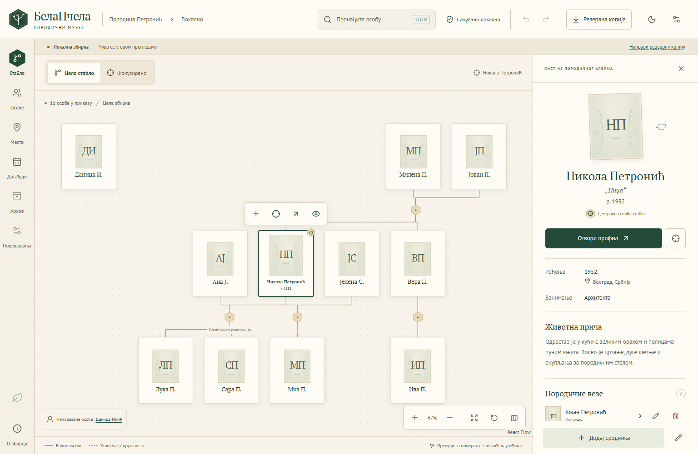

# БелаПчела

**Your family tree, stories and keepsakes — in a private family museum.**

БелаПчела is an offline-capable genealogy app with a Serbian Cyrillic interface. Explore generations on an interactive tree, write family biographies, record shared events and places, and keep photographs, documents and recordings alongside the people they belong to.

The app runs in your browser. Family data and original files stay in that browser profile; there are no accounts, analytics or cloud synchronization. A static server delivers the application files. Complete ZIP backups let you keep independent copies and move a collection to another browser or device.



*Invented demonstration family. [View the dark theme](docs/images/family-tree-dark.png).*

[Упутство на српском](docs/USER_GUIDE.sr.md) · [Development](docs/DEVELOPMENT.md) · [Archive format](ARCHIVE_FORMAT.md) · [Release notes](CHANGELOG.md)

## What you can do

- **Explore your family:** pan and zoom, search people, focus on a connected family, collapse descendants and open full profiles while preserving your tree viewpoint.
- **Build a chronicle:** optional names, aliases, occupations, biography, contacts, custom facts, approximate dates and life events. Empty sections stay out of the reading view.
- **Record relationships accurately:** biological, adoptive and other parentage; multiple partnerships; direct kinship assertions. Add, edit, review and delete relationships with undo/redo. Unknown parents remain unknown; parenthood never implies marriage.
- **Connect events and places:** reusable locations, historical names, coordinates, participants and roles, date precision and periods. The coordinate picker works offline.
- **Preserve original keepsakes:** photographs, PDF/text documents, audio and video; captions, tags, galleries and preferred portraits. One file can link to several people, events or places.
- **Manage collections:** start an empty family, keep several independent collections, switch between them, and import a reviewed ZIP or data-only JSON copy.
- **Work comfortably:** botanical light/dark themes, responsive screens, keyboard controls and an installable offline app shell.

## Start your family

1. Open the app. The first visit includes an **invented Петронић family** to explore.
2. Choose **Подешавања → Нова породична збирка**, enter a name and select **Направи празну збирку**. Existing collections remain available.
3. Select **Додај прву особу**. Every biographical field is optional. Save, then use **Додај сродника** to build the tree.
4. Add events, places and files from **Догађаји**, **Места** and **Архив**.
5. Use **Направи резервну копију** regularly and save the full ZIP somewhere independent of the browser.

For a hosted copy, these steps require no developer tools. See the [Serbian user guide](docs/USER_GUIDE.sr.md) for editing, keyboard shortcuts, backup restoration and troubleshooting.

## Your data and backups

**The working collection lives in IndexedDB, tied to a browser profile and site origin (scheme, host and port).** Opening the same website on another device does not bring its family data with it. Hosting the app on your own server does not create server-side family backups.

Clearing site data, losing a browser profile or storage eviction can remove a collection. Requesting persistent storage in Settings can reduce eviction risk, but independent ZIP backups remain essential. Use a regular browser profile for lasting work.

| Copy | Contains | Use |
| --- | --- | --- |
| Full ZIP | Family records, relationships and original media files | Complete backup and transfer |
| Data-only JSON | Family records and file descriptions/links | Data exchange; cannot restore originals |

Import always shows a review. Opening as a new collection keeps existing collections. Replacing a collection requires explicit confirmation and clears session undo history. Backups are unencrypted; store and share them with care. The [archive format](ARCHIVE_FORMAT.md) documents validation, compatibility and size limits.

## Offline use

After opening a production build over HTTPS or localhost, wait for **Апликација је спремна за рад без интернета.** You can then reopen the cached app and use its locally stored collection offline. Install it through the browser's **Install app / Add to home screen** menu when available.

Updates wait for you to save open work and choose **Ажурирај и поново отвори**. Development mode does not install the offline shell. Real Safari/iOS installation still needs device testing.

## Local development and build

Use **Node.js 24** (see [.nvmrc](.nvmrc)) and npm. Node.js 22.13 or newer within the 22.x line is also supported. On Windows, use `npm.cmd` if PowerShell blocks `npm.ps1`.

```sh
npm ci
npm run dev
```

Vite prints a local development URL. To check the project and produce the static application:

```sh
npm run check
```

This runs unit/component tests, verifies license notices, checks TypeScript and writes a production build to `dist/`. A build does not start a server. Browser testing and the code structure are covered in [Development](docs/DEVELOPMENT.md). Notes for a later server setup are in [Server handoff](docs/SERVER_HANDOFF.md).

## Scope of v1

БелаПчела is intended for personal family collections. Browser storage and backup transfers have finite limits: 25 MiB per original file, 250 MiB per ZIP and 2,000 originals per backup. Graph testing includes collections with 1,200 people; complex networks can take longer to arrange.

V1 supports relationship deletion. Deleting people, events, places, media or whole collections is not yet available. A dedicated source/evidence editor, GEDCOM exchange, online map tiles/geocoding, photo annotations, collaboration and automatic synchronization are outside this release. Existing source records survive compatible archive transfers.

The UI is Serbian Cyrillic; there is no language switch. Mobile testing uses Chromium emulation, with editing primarily designed for desktop. See [known limitations](docs/DEVELOPMENT.md#known-limitations) for technical details.

## Contributing and license

Bug reports and improvements are welcome; see [Contributing](CONTRIBUTING.md). Please use invented examples in public issues and screenshots.

БелаПчела's application code is licensed under [MIT](LICENSE). Dependencies and fonts retain their own licenses; their full notices are bundled in [third-party notices](public/licenses/THIRD_PARTY_NOTICES.txt) and accessible from **О збирци**.
